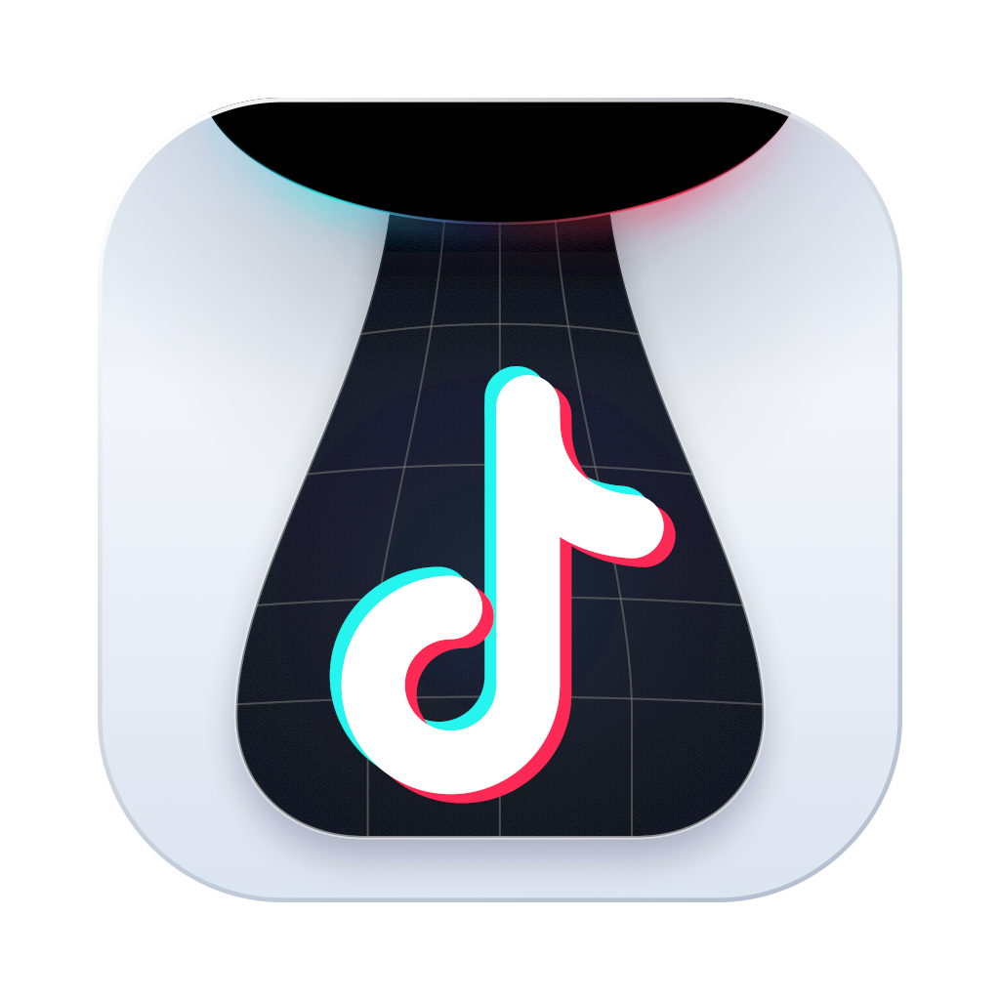
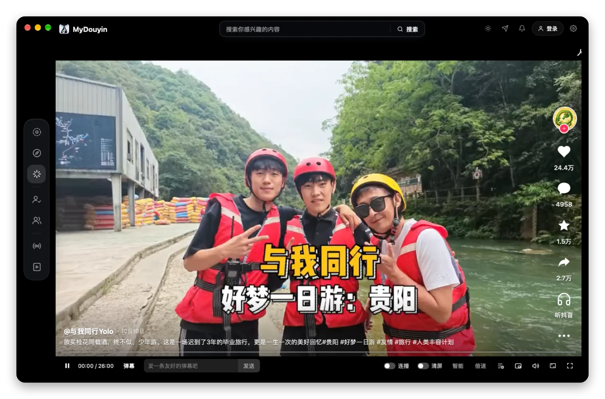

<div align="center">



# MyDouyin

**A lightweight, native Douyin desktop client for macOS & Windows**

Built with Go and [MyGo](https://github.com/egoist/mygo) — no Electron wrapper, low memory usage, zero video disk caching on macOS, an Orbit discovery home screen, and smooth native playback.

[简体中文](README.md) · **English**

[](https://github.com/margbug01/MyDouyin/releases/latest)   

**[Download Latest Release](https://github.com/margbug01/MyDouyin/releases/latest)** · [Why MyDouyin](#why-mydouyin) · [Video Player](#native-video-player) · [Install](#installation) · [FAQ](#faq)

<br>


</div>

> [!IMPORTANT]
> MyDouyin is an independent personal project and is not affiliated with or endorsed by Douyin or ByteDance. Everything runs locally on your machine with zero telemetry or analytics. Use only with your own account and follow platform terms.

## What Is MyDouyin?

**MyDouyin** is a native desktop client for **Douyin** (Chinese TikTok) supporting **macOS (Apple Silicon)** and **Windows 10/11 (x64)**. Instead of wrapping a full Chromium/Electron runtime, MyDouyin draws its interface natively with Go and [MyGo](https://github.com/egoist/mygo): macOS renders video directly through Apple's AVFoundation `AVPlayerLayer` without writing video files to disk, while Windows decodes in hardware with the system's own Media Foundation and draws the frames as GPU textures.

You can browse public videos, search, and explore the Orbit home page immediately without signing in, or scan a QR code in-app to unlock likes, saves, comments, danmaku, follows, live rooms, and watch-history sync.

## Why MyDouyin

| Area | MyDouyin (Native Desktop) | Web Browser | Electron Desktop Client |
| --- | --- | --- | --- |
| **Architecture** | Go + MyGo native UI, dual themes, floating pill navigation | Browser tabs competing with extensions and memory | Bundled Chromium with multiple persistent processes |
| **Launch Experience** | Opens to the **Orbit** search + curated card home instead of instant autoplay | Autoplays recommended feed on open | Autoplays immediately on launch |
| **Playback & Disk I/O** | AVFoundation on macOS and Media Foundation on Windows, both with **zero persistent disk cache** | Continuous browser media caching | High media & renderer cache footprint |
| **Memory Footprint** | ~**65 MB** 1080p native decoder layer; ~**80 MB** on-demand sign page released after 10 s idle | Grows steadily during long browsing sessions | High baseline memory usage |
| **Updates** | Signed in-app delta updates via top-right pill | Web-only | Full installer downloads |

## Native Video Player

<div align="center">



</div>

Watch vertical and landscape videos with smooth slide transitions, auto-hiding playback controls, lane-managed real-time danmaku, side-by-side comments with image lightbox and emoji picker, picture-in-picture, audio-only mode, playback speed, resolution switching, and HLS live rooms.

## Key Features

| Feature | Details |
| --- | --- |
| **Orbit Home Screen** | Opens to a centered search bar surrounded by 8 floating video cards instead of noisy autoplay. Switch between Picks, Following, Watch Later, and History, refresh non-repeating batches, or toggle distraction-free search and trending topics. |
| **Dual Themes & Floating Rail** | Full-app **Pure Black** and **Porcelain White** themes with one-click toggle in the top bar. The left floating pill collapses to icons at rest and expands on hover across Orbit, Picks, Recommend, Following, Friends, Live, and Short Dramas. |
| **Native Video & Live Streaming** | macOS uses AVFoundation `AVPlayerLayer` with single-item metadata preload for fast switching; Windows plays VOD and HLS live streams with the system's Media Foundation, no bundled decoder, and switches to the next live stream when one shows no picture. |
| **Comments, Replies & Danmaku** | Virtualized comment list, nested replies, Douyin emoji picker, image comments (file picker, clipboard paste, drag-and-drop), full-resolution image viewer, clickable `@mentions`, and real-time danmaku. |
| **On-Demand Lightweight Signing** | Write actions (like, save, follow, comment, danmaku, watch history) spin up a ~80 MB signing page only when needed and release it after 10 s idle. Single-instance lock prevents duplicate sessions from invalidating login. |

## Measured Performance

Numbers verified directly in this repository (see [PERFORMANCE.md](PERFORMANCE.md) and [CHANGELOG.md](CHANGELOG.md)):

- **~65 MB 1080p video decoder memory** on macOS via native `AVPlayerLayer` (down from ~180 MB on the older CPU-copied frame path).
- **Zero persistent video disk writes on macOS** using `AVURLAssetUsesNoPersistentCacheKey` (eliminating ~300 MB of temporary disk writes per 8 videos watched).
- **~80 MB on-demand signing page** (down from 340–520 MB full web page), automatically freed after **10 seconds** idle.
- **Virtualized grids and comments** with display-sized image decoding and immediate CPU pixel release after GPU texture upload.

## Installation

### macOS (Apple Silicon)

1. Download `mydouyin-<version>-arm64.dmg` from [GitHub Releases](https://github.com/margbug01/MyDouyin/releases/latest).
2. Open the disk image and drag **MyDouyin.app** into **Applications**.
3. Because the app is not notarized by Apple yet, allow it under **System Settings › Privacy & Security › Open Anyway**, or run:

```sh
xattr -dr com.apple.quarantine /Applications/MyDouyin.app
```

4. **In-app updates**: When a newer release is published, click the top-right update pill to review release notes and install the signed delta update automatically.

### Windows 10 / 11 (x64)

1. Download `mydouyin-setup-<version>-amd64.exe` (or portable archive `mydouyin-<version>-windows-amd64.tar.gz`) from [GitHub Releases](https://github.com/margbug01/MyDouyin/releases/latest).
2. Video plays through the system's Media Foundation, so no decoder needs installing. Windows N and KN editions ship without it: install the Media Feature Pack from **Settings › Apps › Optional features** first.
3. If Windows SmartScreen warns on first launch, choose **More info › Run anyway** (you can verify integrity against `SHA256SUMS` in the release).

### Keyboard Shortcuts

| Action | Key |
| --- | --- |
| Play / Pause | `Space` |
| Previous / Next video | `↑` / `↓` |
| Dismiss dialog / image viewer / PiP / go back | `Esc` |
| Previous / Next comment image | `←` / `→` |
| Zoom comment image in / out / reset | `+` / `-` / `0` |

## Build From Source

Requires **Go 1.27.3+** (uses `go tool mygo`).

```sh
go run .
go test ./...
```

- **macOS (builds macOS and/or Windows releases with bounded disk retention)**: `./scripts/build-release.sh` (keeps only the latest 1 `build.noindex/release-*` by default).
- **Windows (PowerShell 7)**: `./scripts/build-windows.ps1` (prunes old `build.noindex/release-*` directories automatically).

## FAQ

<details>
<summary><strong>Which operating systems does MyDouyin support?</strong></summary>

MyDouyin supports **macOS on Apple Silicon (arm64)** and **Windows 10/11 (x64)**. macOS uses native AVFoundation playback, and Windows uses the system's Media Foundation (N and KN editions need the Media Feature Pack).
</details>

<details>
<summary><strong>Can I use MyDouyin without logging into a Douyin account?</strong></summary>

Yes. Dismiss the QR login prompt on first launch to browse Orbit Picks, recommendations, categories, search results, creator profiles, and public live rooms. Sign in via QR code anytime from the top-right button when you want to like, save, follow, comment, or sync watch history.
</details>

<details>
<summary><strong>Why does MyDouyin avoid disk bloat on macOS?</strong></summary>

MyDouyin configures macOS AVFoundation streams with `AVURLAssetUsesNoPersistentCacheKey`, so video playback buffers briefly in memory instead of writing full MP4 files into `$TMPDIR/MediaCache`.
</details>

<details>
<summary><strong>Where are MyDouyin settings and login sessions stored?</strong></summary>

All credentials and preferences stay locally on your device (`~/Library/Application Support/Douyin` and `~/Library/Application Support/mydouyin` on macOS, or `%APPDATA%` on Windows) and persist across in-app updates.
</details>
