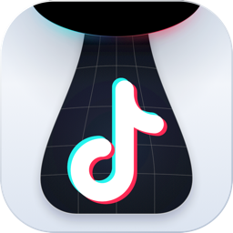
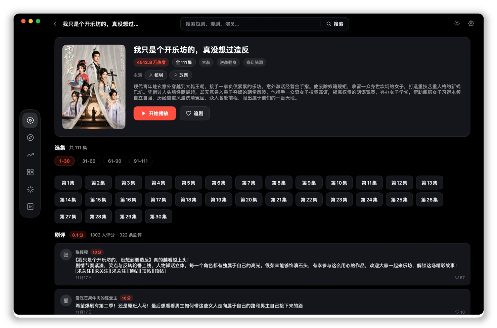
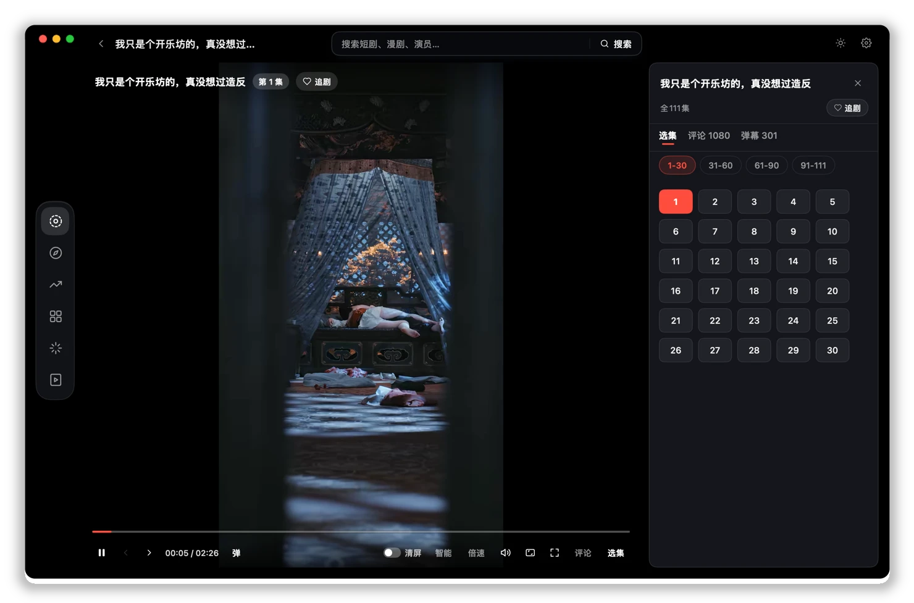

<div align="center">

<p>
  
  &nbsp;&nbsp;&nbsp;&nbsp;
  
</p>

# MyDouyin · MyHongguo

**Open-source native desktop client for Douyin and Hongguo Short Dramas (macOS / Windows)**

**MyDouyin** is a lightweight native desktop application built with Go and [MyGo](https://github.com/egoist/mygo) for **macOS (Apple Silicon)** and **Windows 10/11 (x64)**. It combines **MyDouyin** (Douyin / Chinese TikTok) and **MyHongguo** (Hongguo Short Dramas) in one window without Electron, Android emulators, FFmpeg binaries, or paid Windows Store HEVC extensions.

[简体中文](README.md) · **English**

[](https://github.com/margbug01/MyDouyin/releases/latest)    [](LICENSE)

[](https://awesomemygo.dev/apps/mydouyin)

**[Download Latest Release](https://github.com/margbug01/MyDouyin/releases/latest)** · [What It Is](#what-is-mydouyin--myhongguo) · [Comparison](#why-use-mydouyin-instead-of-web-electron-or-android-emulators) · [Douyin Mode](#mydouyin-mode-orbit-native-playback-live-rooms-and-comments) · [Hongguo Mode](#myhongguo-mode-desktop-short-dramas-and-animated-dramas-without-login) · [Benchmarks](#measured-performance-and-resource-usage) · [Install](#installation-and-updates) · [FAQ](#faq)

<br>


</div>

> [!IMPORTANT]
> MyDouyin is an independent open-source project and is not affiliated with Douyin, Hongguo, or ByteDance. All data stays locally on your machine with zero telemetry or analytics. Use only with your own account and follow each platform's terms of service.

## What is MyDouyin · MyHongguo?

**MyDouyin** is an open-source native desktop client for **macOS (Apple Silicon)** and **Windows 10/11 (x64)** that integrates both **Douyin** and **Hongguo Short Dramas** (红果短剧) inside a single application. Built with Go and [MyGo](https://github.com/egoist/mygo), MyDouyin draws its UI natively and decodes video through OS hardware pipelines instead of wrapping Chromium/Electron or requiring an Android emulator to watch Hongguo dramas on desktop.

| Property | Specification |
| --- | --- |
| **Category** | Native desktop client for Douyin and Hongguo Short Dramas |
| **Supported platforms** | macOS (Apple Silicon / arm64), Windows 10 / 11 (x64) |
| **Video playback engine** | Native AVFoundation on macOS (zero persistent disk cache); native Media Foundation + D3D11 GPU textures on Windows (no FFmpeg) |
| **Hongguo decryption and covers** | Pure-Go streaming ISO-BMFF CENC (AES-128-CTR) decryption; ImageIO on macOS and pure-Go `h265/heic` on Windows |
| **Account model** | MyHongguo runs anonymously without login; MyDouyin browses public feeds without login and supports in-app QR sign-in for interactive writes |
| **Updates and privacy** | Signed in-app delta updates; credentials, tracking history, and preferences stay strictly local |

## Why use MyDouyin instead of web, Electron, or Android emulators?

Watching Douyin or Hongguo Short Dramas on desktop typically forces trade-offs: browser tabs leak memory, Electron wrappers keep heavy Chromium processes resident, and Hongguo lacks a native desktop app so users resort to resource-heavy Android emulators. MyDouyin replaces those workarounds with one lightweight native binary.

| Dimension | MyDouyin · MyHongguo (Native Desktop) | Web Browser | Electron App / Android Emulator |
| --- | --- | --- | --- |
| **Platform coverage** | Douyin and Hongguo Short Dramas in one window with shortcut switching | Douyin runs in browser tabs; Hongguo has no full desktop web app | Usually single-platform; Hongguo requires running a full Android VM |
| **Launch experience** | Opens to an Orbit search and card canvas backed by local fast-start snapshots | Autoplays the recommended feed immediately | Slow cold start with multiple resident background processes |
| **Video decode and disk I/O** | AVFoundation on macOS (zero disk cache); Media Foundation on Windows | Continuous browser media caching across tabs | Heavy virtualization overhead, fan noise, and disk writes |
| **Hongguo HEIC covers** | System ImageIO on macOS; built-in pure-Go `h265/heic` decoder on Windows | Depends on browser HEIC support | Requires extra codec packs or a full Android runtime |
| **Memory footprint** | ~**65 MB** 1080p native decoder on macOS; ~**80 MB** on-demand signing page freed after 10 s idle | Climbs over long browsing sessions | Typically 500 MB to 2 GB+ resident memory |
| **Desktop updates** | Signed in-app delta updates via top-right pill | Web-only | Full installer downloads |

## How to switch between Douyin and Hongguo modes

Click the top-left brand switcher pill, or press `Cmd+1` / `Cmd+2` on macOS (`Ctrl+1` / `Ctrl+2` on Windows), to switch directly between **MyDouyin** and **MyHongguo**.

- Both modes share the Porcelain White and Pure Black themes with distinct brand accents, floating navigation rails, and unified top-bar alignment across macOS and Windows.
- Mode switches automatically checkpoint watch progress and release the outgoing media player before initializing the incoming mode.
- Hongguo services initialize lazily on first entry, so staying in Douyin mode produces zero Hongguo network traffic.

## MyDouyin mode: Orbit, native playback, live rooms, and comments

MyDouyin mode provides desktop Douyin discovery, native video and live playback, and full comment interaction while keeping memory and disk writes bounded.

<div align="center">


</div>

| Module | Capabilities |
| --- | --- |
| **Orbit home screen** | Opens to a centered search bar ringed by 8 video cards. Switch among Picks, Following, Watch Later, and History, cycle non-repeating batches via click or scroll wheel, toggle pure search or trending topics, and render cached snapshots immediately on launch. |
| **Native VOD and prewarming** | Vertical slide transitions, auto-hiding controls and cursor, resolution and speed menus, autoplay-next, clean screen, audio-only listening, picture-in-picture, theater mode, and fullscreen. Both macOS and Windows prewarm the next video during playback, and the Windows loopback proxy caches the first 256 KiB of VOD streams in RAM. |
| **Live streaming** | Multi-quality H.264 stream selection, automatic primary/backup CDN failover, live danmaku, chat feed, and in-app gifting. |
| **Comments and media replies** | Virtualized comment list, nested reply threads, Douyin emoji picker, image uploads via file dialog, clipboard paste, or drag-and-drop, full-resolution image viewer, and clickable `@mentions` and user avatars. |
| **Channels and watch history** | Covers Picks, Recommend, Following, Friends, Live, Short Dramas, Mixes, Creator Profiles, Likes, Saves, Watch History, Watch Later, read-only DMs, and Notifications. Videos watched past 2 seconds batch-report to Douyin watch history. |
| **Lightweight signing and single instance** | Write actions open an ~80 MB signing page on demand and destroy it after 10 seconds idle. A single-instance lock prevents duplicate launches from invalidating sessions. |

## MyHongguo mode: desktop short dramas and animated dramas without login

MyHongguo mode brings Hongguo Short Dramas natively to macOS and Windows with zero login and no Android emulator, combining a dual-wing Orbit home, rankings and filters, streaming CENC decryption, danmaku, comments, and local episode resume.

<div align="center">


<br>

<table>
  <tr>
    <td align="center" width="50%">
      
      <br><sub>Series Detail · Grouped Episodes · Reviews</sub>
    </td>
    <td align="center" width="50%">
      
      <br><sub>Native Episode Player · Episodes / Comments / Danmaku</sub>
    </td>
  </tr>
</table>

</div>

| Module | Capabilities |
| --- | --- |
| **Dual-wing Orbit home** | Places 3:4 portrait drama posters in two balanced wings around the search bar (live-action on the left, animated dramas on the right). Switch among Dual, Live-action, Animated, and Tracking views, cycle batches with the scroll wheel, and load cached snapshots immediately on open. |
| **Catalog, rankings, and search** | Floating left rail covers Orbit, Discover (Recommend, Live-action, Animated), Rankings (series and actor boards), multi-row Filter panel, New Releases by date, filtered Search (Live-action, Animated, AI Drama, Film), and Actor profile pages. |
| **Detail cache and target pre-resolution** | Displays ratings, status tags, clickable cast pills, synopsis, multi-season switching, grouped episode grids, series reviews with replies, and related series. Caches 16 recent series in memory for 5 minutes and pre-resolves + prewarms the target episode as soon as episodes load. |
| **Encrypted streaming playback** | Resolves anonymous playback URLs and decrypts ISO-BMFF CENC (AES-128-CTR) streams on the fly through a loopback proxy. Probes 512 KiB in a single round trip to capture `moov` and opening frames, streams cached head bytes immediately, pre-resolves and prewarms the next episode at 75% progress, and auto-advances at EOF. |
| **Danmaku, comments, and local tracking** | Side drawer integrates episode selector, episode comments, series reviews, and clickable danmaku timestamps alongside real-time danmaku overlay. Persists favorites and per-episode resume positions locally every 2 seconds. |
| **Cross-platform HEIC covers and settings** | Decodes signed Hongguo HEIC covers via ImageIO on macOS and pure-Go `h265/heic` on Windows, saving compact JPEG disk caches. Settings include direct connection (bypassing system proxy by default), optional remote signer URL/token, and one-click anonymous device reset. |

## Measured performance and resource usage

All figures come from measurements recorded in this repository (see [PERFORMANCE.md](PERFORMANCE.md) and [CHANGELOG.md](CHANGELOG.md)):

- **~65 MB 1080p decoder memory on macOS**: Switching to `AVPlayerLayer` reduced `VTDecoderXPCService` physical footprint from ~180 MB to ~65 MB.
- **Zero persistent video disk writes on macOS**: Setting `AVURLAssetUsesNoPersistentCacheKey` keeps playback in bounded memory buffers instead of writing ~300 MB of temporary MP4 files per 8 watched videos.
- **~80 MB on-demand signing page**: Replaces a 340 to 520 MB full Douyin web page and frees automatically after 10 seconds idle.
- **Bounded memory across long lists**: Virtualized grids and comment lists, 12 concurrent cover downloads, 4 concurrent decoders, display-sized scaling, and CPU pixel release after GPU texture upload.
- **Lower click-to-play latency**: 512 KiB single-RTT CENC probe covers typical 252 KiB Hongguo `moov` boxes; 256 KiB VOD head cache serves Windows proxy `HEAD` and opening ranges from RAM; HTTP pools set `MaxIdleConnsPerHost=16` to avoid repeated TLS handshakes.

## Installation and updates

### macOS (Apple Silicon)

1. Download the latest `mydouyin-<version>-arm64.dmg` from [GitHub Releases](https://github.com/margbug01/MyDouyin/releases/latest).
2. Open the `.dmg` and drag **MyDouyin.app** into **Applications**.
3. Because the build is not Apple-notarized yet, allow it under **System Settings › Privacy & Security › Open Anyway**, or run:

```sh
xattr -dr com.apple.quarantine /Applications/MyDouyin.app
```

4. When a newer release ships, click the update pill in the top-right corner to view release notes and install the signed delta update automatically.

### Windows 10 / 11 (x64)

1. Download `mydouyin-setup-<version>-amd64.exe` (or the portable archive `mydouyin-<version>-windows-amd64.tar.gz`) from [GitHub Releases](https://github.com/margbug01/MyDouyin/releases/latest).
2. Run directly to play Douyin and Hongguo videos and render HEIC covers with **no FFmpeg binary or Windows Store HEIF/HEVC extension required**. Windows N and KN editions need the **Media Feature Pack** under **Settings › Apps › Optional features**.
3. If Windows SmartScreen warns on first launch, choose **More info › Run anyway** and verify checksums against `SHA256SUMS` if desired.

### Keyboard shortcuts

| Action | Shortcut |
| --- | --- |
| Switch to MyDouyin mode | `Cmd+1` (macOS) / `Ctrl+1` (Windows) |
| Switch to MyHongguo mode | `Cmd+2` (macOS) / `Ctrl+2` (Windows) |
| Play or pause current video or episode | `Space` |
| Previous or next video or episode | `Up` / `Down` |
| Close dialog, exit viewer or fullscreen, or go back | `Esc` |
| Previous or next image in comment lightbox | `Left` / `Right` |
| Zoom comment image in, out, or reset | `+` / `-` / `0` |

## Build from source

Requires **Go 1.27.3+** (invokes the bundled MyGo toolchain via `go tool mygo`).

```sh
go run .
go test ./...
```

- **macOS (builds both `darwin/arm64` and `windows/amd64` releases)**: Run `./scripts/build-release.sh`. It builds from a clean Git archive and keeps only the latest 1 `build.noindex/release-*` directory by default (run `./scripts/build-release.sh --prune-only --keep 0` after uploading to free disk space).
- **Publish to Cloudflare R2 update feed and GitHub Releases**: Run `./scripts/publish-release.sh` (uploads versioned binaries to `https://dl.imclawd.tech/mydouyin/` first, then `no-cache` manifests, and mirrors the release to GitHub Releases).
- **Windows (PowerShell 7)**: Run `./scripts/build-windows.ps1`, which also prunes old `build.noindex/release-*` directories automatically.

## FAQ

### Is there a desktop client for Hongguo Short Dramas without using an Android emulator?

Yes. MyDouyin includes a native **MyHongguo** mode that runs directly on macOS (Apple Silicon) and Windows 10/11 (x64) without Android emulators or screen mirroring. Click the top-left brand pill or press `Cmd+2` / `Ctrl+2` to browse Dual-Wing Orbit, Discover, Rankings, Filters, New Releases, Search, series details, danmaku, comments, and local episode resume.

### What works without logging into a Douyin or Hongguo account?

MyHongguo mode works completely anonymously with local favorites and per-episode resume progress. MyDouyin mode lets you browse Orbit Picks, recommendations, categories, search, creator profiles, and public live rooms without signing in; QR login is only required for Douyin likes, saves, follows, comments, danmaku, and account watch-history sync.

### Do I need FFmpeg or Microsoft Store HEIF/HEVC extensions on Windows?

No. Windows builds decode video natively through Windows Media Foundation with no bundled FFmpeg, and decode Hongguo's signed HEIC covers with an embedded pure-Go `h265/heic` decoder cached locally as JPEG. Only Windows N and KN editions need the built-in OS Media Feature Pack.

### Does MyDouyin fill up disk space when watching videos on macOS?

No. MyDouyin sets `AVURLAssetUsesNoPersistentCacheKey` on macOS AVFoundation streams so playback buffers briefly in memory instead of writing full MP4 files into `$TMPDIR/MediaCache`, and the local thumbnail cache enforces a strict file count cap.

### What should I do if Hongguo fails to load behind a proxy or hits anonymous limits?

Open **Settings** in the top-right corner and check the **MyHongguo** section. Direct connection (bypassing system proxy) is enabled by default. Click **Reset anonymous device** if an anonymous profile is rate-limited, or optionally configure a custom remote signer URL and token.

### How do I open MyDouyin on macOS if Gatekeeper blocks an unnotarized app?

Drag **MyDouyin.app** into `/Applications`, click **Open Anyway** under **System Settings › Privacy & Security**, or run `xattr -dr com.apple.quarantine /Applications/MyDouyin.app` in Terminal.

### Where are login sessions, Hongguo tracking lists, and settings stored?

All personal data stays in standard local OS configuration directories (`~/Library/Application Support/Douyin` and `~/Library/Application Support/mydouyin` on macOS, or `%APPDATA%` on Windows) and persists across manual upgrades and in-app delta updates.

## Acknowledgements

MyDouyin · MyHongguo builds on and draws inspiration from the following open-source projects and contributors:

- **[MyGo](https://github.com/egoist/mygo)**: Native Go cross-platform UI, OS media playback, and signed delta update framework powering this app.
- **[openhongguo](https://github.com/beilunyang/openhongguo)** (and upstream contributor **[J3n5en/openhongguo](https://github.com/J3n5en/openhongguo)**): Open-source Hongguo Short Drama protocol research and Go SDK behind MyHongguo mode.
- **[purego](https://github.com/ebitengine/purego)**: Calling native OS libraries from Go without CGo.
- **[gen2brain/h265](https://github.com/gen2brain/h265)**: Pure-Go HEVC / HEIC decoding that renders Hongguo covers on Windows without Store codec packs.
- Thanks to everyone in the open-source community who tested builds, reported bugs, and shared feedback.

## Community Links

- **[LINUX DO](https://linux.do)**: A friendly, open-source and technology community.

## License

Licensed under the [Apache License 2.0](LICENSE).
