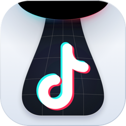
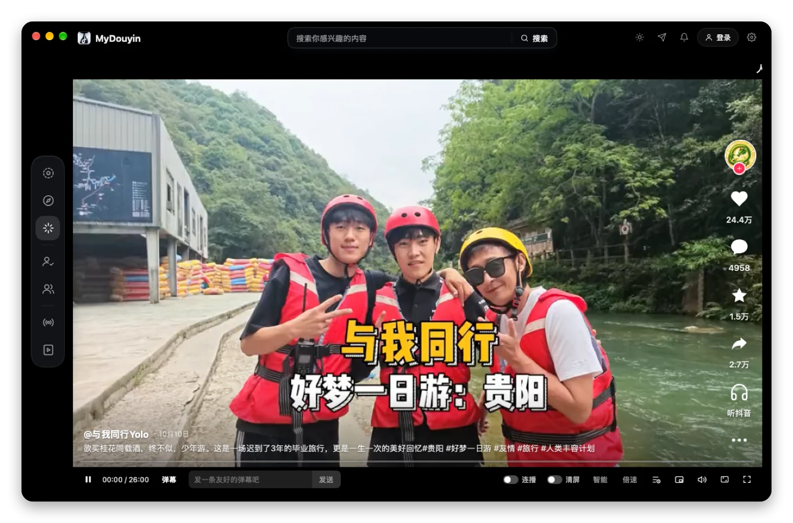
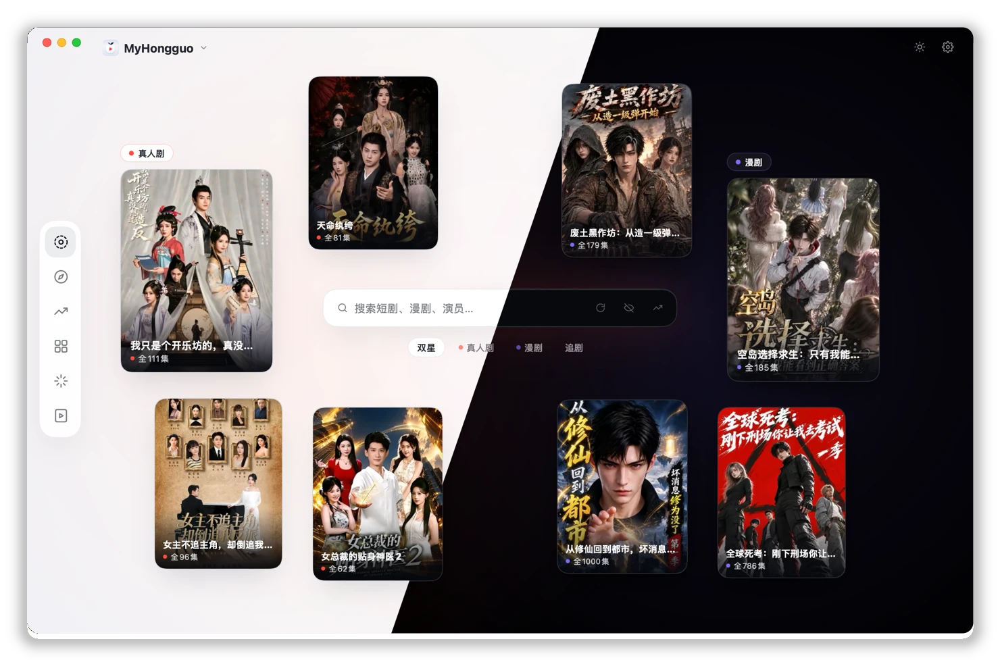
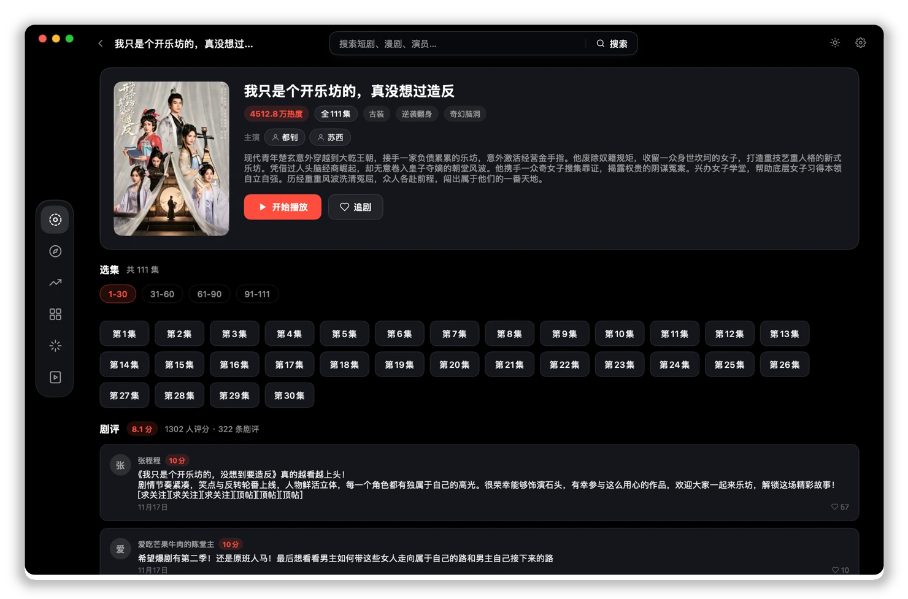
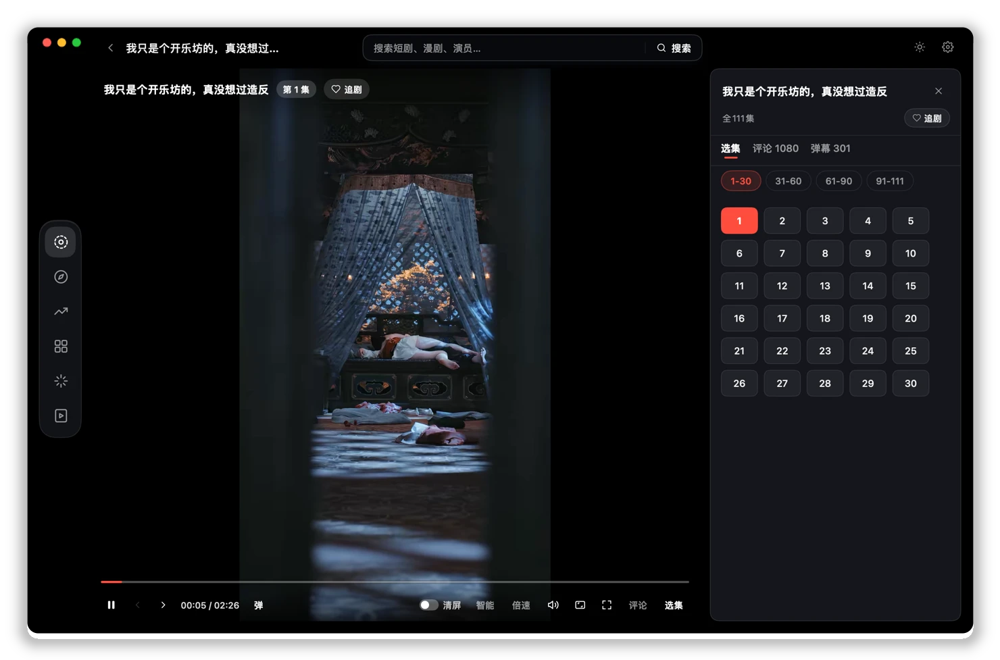

<div align="center">

<p>
  
  &nbsp;&nbsp;&nbsp;&nbsp;
  
</p>

# MyDouyin · MyHongguo

**开源原生抖音桌面客户端 & 红果短剧电脑版（macOS / Windows）**

**MyDouyin** 是基于 Go 与 [MyGo](https://github.com/egoist/mygo) 构建的轻量原生桌面软件，在一个窗口内同时提供 **抖音（MyDouyin）** 与 **红果短剧（MyHongguo）** 两种模式，原生支持 **macOS（Apple Silicon）** 与 **Windows 10/11（x64）**。无需 Electron、无需安卓模拟器、无需额外安装 FFmpeg 或 HEVC 商店扩展，打开即可免登录浏览抖音公开内容与红果免费短剧、漫剧。

**简体中文** · [English](README.en.md)

[](https://github.com/margbug01/MyDouyin/releases/latest)   

**[下载最新版](https://github.com/margbug01/MyDouyin/releases/latest)** · [产品定义](#mydouyin--myhongguo-是什么) · [对比传统方案](#为什么用-mydouyin-替代网页版electron-客户端或安卓模拟器) · [抖音模式](#抖音模式mydouyin引力场原生播放直播与评论) · [红果短剧模式](#红果短剧模式myhongguo电脑端免登录看免费短剧与漫剧) · [性能实测](#实测性能与资源占用数据) · [安装指南](#如何在-macos-与-windows-上安装与更新) · [常见问题](#常见问题faq)

<br>


</div>

> [!IMPORTANT]
> MyDouyin 是个人开源项目，与抖音（Douyin）、红果短剧（Hongguo）及字节跳动没有任何官方关联。应用所有数据仅在本地运行和存储，不收集任何遥测或统计信息。请仅使用个人账号合理浏览，并遵守对应平台的服务条款。

## MyDouyin · MyHongguo 是什么

**MyDouyin** 是一款运行在 macOS（Apple Silicon）与 Windows 10/11（x64）上的开源原生桌面客户端，同时集成 **抖音电脑端浏览** 与 **红果短剧电脑版观看** 两大核心能力。软件使用 Go 语言与原生图形框架 [MyGo](https://github.com/egoist/mygo) 直接绘制界面并调用系统原生硬件解码，不依赖 Electron 或常驻 Chromium 内核，也无需通过安卓模拟器运行红果短剧 App。

| 属性 | 说明 |
| --- | --- |
| **软件定位** | 轻量原生抖音桌面客户端 + 红果短剧电脑版（双模式一体） |
| **支持系统** | macOS（Apple Silicon / arm64）、Windows 10 / 11（x64） |
| **视频解码引擎** | macOS 原生 AVFoundation（零写盘硬解）；Windows 原生 Media Foundation + D3D11 GPU 纹理（无需 FFmpeg） |
| **红果加密与封面** | 内置纯 Go 流式 ISO-BMFF CENC（AES-128-CTR）解密；macOS ImageIO / Windows 纯 Go `h265/heic` 封面解码 |
| **登录要求** | 红果短剧全程免登录匿名播放；抖音支持免登录看公开内容，点赞/评论/同步历史可应用内扫码登录 |
| **更新与隐私** | 支持签名增量热更新（Delta Update）；所有凭证、追剧记录与偏好仅存本机 |

## 为什么用 MyDouyin 替代网页版、Electron 客户端或安卓模拟器

用户在 Mac 或 Windows 上看抖音和红果短剧时，常见痛点是浏览器标签内存持续暴涨、官方或套壳桌面端后台进程臃肿、以及红果短剧缺乏原生电脑版而被迫安装高占用的安卓模拟器。MyDouyin 用一套轻量原生客户端同时解决这两类场景。

| 对比维度 | MyDouyin · MyHongguo（原生桌面端） | 浏览器网页版 | Electron 客户端 / 安卓模拟器 |
| --- | --- | --- | --- |
| **抖音 + 红果覆盖** | 单窗口集成抖音与红果短剧，快捷键一键切换 | 抖音依赖浏览器标签；红果缺少完整桌面网页端 | 通常仅覆盖单一平台，看红果需开整套安卓虚拟机 |
| **打开首屏体验** | 默认进入「引力场」搜索与卡片画布，配合本地快照秒开，不强制连播 | 打开即自动播放推荐流 | 启动耗时长，后台常驻多个高内存进程 |
| **视频解码与写盘** | macOS 走 AVFoundation 原生层（零写盘）；Windows 走 Media Foundation 硬件解码 | 浏览器持续写入媒体缓存，多开标签内存上涨 | 模拟器虚拟化开销高，风扇与硬盘写入明显 |
| **红果 HEIC 封面** | macOS 系统 ImageIO 硬解；Windows 内置纯 Go `h265/heic` 解码并缓存 JPEG | 依赖浏览器对 HEIC 格式支持 | 需要额外编解码组件或完整 Android 运行环境 |
| **内存占用** | macOS 1080p 原生解码约 **65 MB**；抖音写操作签名页约 **80 MB**（闲置 10 秒销毁） | 长时间刷视频易涨至数百 MB 甚至数 GB | 常驻内存普遍在 500 MB 至 2 GB 以上 |
| **桌面更新体验** | 应用内签名增量更新，顶部胶囊一键重启升级 | 无独立桌面更新 | 多需重新下载完整安装包 |

## 如何在抖音与红果短剧之间一键切换

在 MyDouyin 中切换抖音模式与红果短剧模式只需一次点击或一组快捷键：点击窗口左上角的品牌切换胶囊，或按下 `⌘1` / `⌘2`（Windows 为 `Ctrl+1` / `Ctrl+2`），即可在 **MyDouyin** 与 **MyHongguo** 之间切换。

- 两种模式共享「极净瓷白」浅色主题与「纯黑黑洞」深色主题，各自保留独立强调色与左侧悬浮胶囊导航，且 macOS 与 Windows 顶栏品牌位置统一对齐。
- 切换模式时自动保存当前观看进度并释放退出模式的播放器，避免后台音频残留或双播放器占内存。
- 红果服务采用懒初始化策略，仅在首次切入 MyHongguo 时创建实例，日常只用抖音不会触发任何红果请求。

## 抖音模式（MyDouyin）：引力场、原生播放、直播与评论

MyDouyin 的抖音模式为桌面端提供完整的刷视频、看直播、逛主页与评论区互动体验，同时通过引力场首页、原生硬解和按需签名控制内存与磁盘占用。

<div align="center">



</div>

| 功能模块 | 具体能力 |
| --- | --- |
| **引力场首页（Orbit）** | 启动进入居中搜索框与 8 张错落视频卡片，支持一键切换「精选 / 关注 / 稍后 / 历史」、鼠标滚轮或触控板无重复换批、纯静搜索、抖音热搜，以及本地未看环快照秒开首屏。 |
| **原生点播与起播预热** | 支持上下平滑切视频、自动隐藏控制栏与鼠标光标、清晰度与倍速切换、连播、清屏、听抖音、小窗播放、网页全屏与系统全屏。macOS 与 Windows 均支持播放时预热下一条视频，Windows 回环代理缓存前 256 KiB 视频头减少起播等待。 |
| **直播间观看与互动** | 覆盖直播频道与直播间，支持多档位 H.264 清晰度（原画 / 蓝光 / 超清 / 高清 / 标清 / 智能）、主备 CDN 线路自动容灾切换，以及实时弹幕、直播评论和常规礼物送出。 |
| **评论区与带图互动** | 虚拟化滚动评论列表与楼中楼展开回复、抖音官方表情面板、文件选图/粘贴截图/拖拽上传带图评论、高清原图查看器（缩放、切换、复制与保存），以及点击头像、昵称和 `@` 提及直达作者主页。 |
| **完整频道与观看历史** | 覆盖精选分区、推荐、关注、朋友、直播、短剧、合集、作者主页、我的作品/喜欢/收藏/观看历史/稍后再看、私信（只读）与通知。视频观看满 2 秒自动攒批上报观看历史，避免推荐流反复刷到已看内容。 |
| **按需轻量签名与单实例** | 仅在点赞、收藏、关注、发评论、发弹幕等写操作时拉起约 80 MB 的轻量签名页，闲置 10 秒自动释放；单实例运行防止多开互踢登录态。 |

## 红果短剧模式（MyHongguo）：电脑端免登录看免费短剧与漫剧

MyHongguo 是内置在 MyDouyin 中的红果短剧电脑端模式，支持在 Mac 与 Windows 上免登录、免安卓模拟器直接浏览和播放红果免费短剧与漫剧，包含双星引力场首页、榜单分类、流式加密解密、弹幕评论与本地追剧续播。

<div align="center">



<br>

<table>
  <tr>
    <td align="center" width="50%">
      
      <br><sub>红果剧集详情 · 分组选集 · 剧评</sub>
    </td>
    <td align="center" width="50%">
      
      <br><sub>原生短剧播放 · 选集 / 评论 / 弹幕抽屉</sub>
    </td>
  </tr>
</table>

</div>

| 功能模块 | 具体能力 |
| --- | --- |
| **红果双星引力场** | 围绕 3:4 竖版海报构建左右双翼首页（左翼真人剧暖红氛围光、右翼漫剧靛紫氛围光），支持 `双星 / 真人剧 / 漫剧 / 追剧` 四种视图、点击翼头聚焦单频道、滚轮翻批、搜索联想与短剧热搜，并缓存真人剧与漫剧首屏快照。 |
| **全频道找剧与排行** | 侧边悬浮导航涵盖「引力场 / 发现 / 榜单 / 分类 / 上新 / 追剧」。发现页提供推荐、真人剧、漫剧；榜单涵盖剧集榜与演员榜；分类页支持多维条件筛选；上新页按日期浏览；搜索页支持按真人剧、漫剧、AI剧、影视剧过滤，并可直达演员主页看全部作品。 |
| **详情页缓存与首集预热** | 展示评分、热度、状态标签、主演跳转、简介、多季切换、分组选集、剧评与楼中楼回复及相关推荐。内置近期 16 部剧集的 5 分钟内存缓存，选集加载后后台预解析并预热目标集，点「开始播放」即可跳过解析等待。 |
| **流式解密与连播体验** | 匿名解析播放地址并内置纯 Go 流式 ISO-BMFF CENC（AES-128-CTR）回环解密。首轮 512 KiB 单次探测拉齐 `moov` 与开篇关键帧，配合头部缓存零等待吐出首包、75% 进度预解析并预热下一集、播完自动连播下一集。 |
| **弹幕、评论与本地追剧** | 播放页右侧抽屉集成选集、本集评论、剧评与弹幕列表（点击弹幕可直接跳转对应时间点），画面实时渲染避让弹幕。本地持久化「我的追剧」与「最近观看」，每 2 秒记录断点并支持一键续播。 |
| **跨平台 HEIC 封面与网络设置** | macOS 通过系统 ImageIO 解码、Windows 通过内置纯 Go `h265/heic` 解码红果签名 HEIC 封面并转存紧凑 JPEG 缓存，无需安装商店 HEVC 扩展。设置面板提供「绕过系统代理直连」（默认开启）、可选远端签名服务与一键重置匿名设备。 |

## 实测性能与资源占用数据

以下关键指标均来自本仓库实测记录，完整测试方法见 [PERFORMANCE.md](PERFORMANCE.md) 与 [CHANGELOG.md](CHANGELOG.md)：

- **macOS 1080p 解码内存约 65 MB**：改用 `AVPlayerLayer` 原生视频层后，系统解码进程 `VTDecoderXPCService` 物理内存由约 180 MB 降至约 65 MB。
- **macOS 刷视频零写盘**：通过 `AVURLAssetUsesNoPersistentCacheKey` 禁用系统持久媒体磁盘缓存，消除此前连看 8 条视频向 `$TMPDIR/MediaCache` 写入约 300 MB 的问题。
- **抖音后台签名页约 80 MB 且自动销毁**：写操作仅拉起轻量签名页（对比完整网页约 340 至 520 MB），操作结束并闲置 10 秒后自动释放。
- **长列表与高并发封面可控占用**：网格与评论采用虚拟化按需渲染，封面支持 12 路并发下载与 4 路并发解码，按显示尺寸缩放并在上传 GPU 后立即释放 CPU 像素内存。
- **起播与切集延迟优化**：红果 CENC 首轮探测 512 KiB 一次覆盖实测 252 KiB 的 `moov` 盒；Windows 代理点播预检缓存前 256 KiB 头部字节；HTTP 传输连接池提升至 `MaxIdleConnsPerHost=16`，减少并发封面与分段拉流的重复 TLS 握手。

## 如何在 macOS 与 Windows 上安装与更新

### macOS（Apple Silicon）安装步骤

1. 直接下载最新安装包（Cloudflare 加速源 `https://dl.imclawd.tech/mydouyin/`，或前往 [GitHub Releases](https://github.com/margbug01/MyDouyin/releases/latest)），获取 `mydouyin-<版本>-arm64.dmg`。
2. 双击打开 `.dmg`，将 **MyDouyin.app** 拖入「应用程序（Applications）」目录。
3. 首次打开若因应用未做 Apple 官方公证被系统拦截，在「系统设置 › 隐私与安全性」底部点击「仍要打开」，或在终端执行：

```sh
xattr -dr com.apple.quarantine /Applications/MyDouyin.app
```

4. 后续有新版本发布时，应用自动检查 Cloudflare R2 更新源，窗口右上角出现更新胶囊后点击即可查看更新日志、下载签名增量包并自动重启完成升级。

### Windows 10 / 11（x64）安装步骤

1. 直接下载安装程序 `mydouyin-setup-<版本>-amd64.exe` 或免安装压缩包 `mydouyin-<版本>-windows-amd64.tar.gz`（Cloudflare 加速源 `https://dl.imclawd.tech/mydouyin/`，或前往 [GitHub Releases](https://github.com/margbug01/MyDouyin/releases/latest)）。
2. 直接运行即可播放抖音与红果短剧视频并显示 HEIC 封面，**无需安装 FFmpeg 或微软商店 HEIF/HEVC 扩展**。若使用 Windows N / KN 精简版，请先在「设置 › 应用 › 可选功能」中安装 Media Feature Pack。
3. 首次运行若触发 Windows SmartScreen 拦截，点击「更多信息 › 仍要运行」；如需校验文件完整性，可比对附带的 `SHA256SUMS`。

### 常用快捷键一览

| 操作 | 快捷键 |
| --- | --- |
| 切换到抖音模式（MyDouyin） | `⌘1`（macOS） / `Ctrl+1`（Windows） |
| 切换到红果短剧模式（MyHongguo） | `⌘2`（macOS） / `Ctrl+2`（Windows） |
| 播放 / 暂停当前视频或短剧 | `Space`（空格） |
| 切换上一条 / 下一条视频，或上一集 / 下一集 | `↑` / `↓` |
| 关闭弹窗 / 退出大图预览或全屏 / 返回上一页 | `Esc` |
| 评论原图查看器切换上一张 / 下一张 | `←` / `→` |
| 评论原图放大 / 缩小 / 还原比例 | `+` / `-` / `0` |

## 从源码运行与构建

构建 MyDouyin 需要 **Go 1.27.3** 或更新版本，仓库通过 `go tool mygo` 调用内置 MyGo 工具链。

```sh
# 开发模式直接运行与跑全量测试
go run .
go test ./...
```

- **macOS 构建跨平台发布包（默认同时输出 `darwin/arm64` 与 `windows/amd64`）**：运行 `./scripts/build-release.sh`。脚本从干净 Git 快照构建，`build.noindex/release-*` 默认仅保留最新 1 份，上传后可执行 `./scripts/build-release.sh --prune-only --keep 0` 释放磁盘空间。
- **一键双发到 Cloudflare R2 更新源与 GitHub Releases**：运行 `./scripts/publish-release.sh`（复用本机 `wrangler` 与 `gh`，自动先传大文件再传 `no-cache` 清单；如需只发 R2 可加 `--r2-only`）。
- **Windows 本地构建（PowerShell 7）**：运行 `./scripts/build-windows.ps1`，默认同样自动清理旧产物并仅保留最新 1 份。

## 常见问题（FAQ）

### 红果短剧有电脑版吗？如何在 Mac 和 Windows 上不用安卓模拟器看红果短剧？

MyDouyin 内置了完整的 **MyHongguo 红果短剧模式**，原生运行在 macOS（Apple Silicon）和 Windows 10/11（x64）上，不需要安装安卓模拟器或手机投屏。打开软件后点击左上角品牌胶囊或按 `⌘2` / `Ctrl+2` 即可进入红果短剧模式，支持双星引力场、发现、榜单、分类、上新、搜索、剧集详情、弹幕、评论与断点续播。

### 不登录抖音或红果账号可以直接使用吗？

可以。MyHongguo 红果短剧模式全程免登录匿名运行，追剧收藏和每集播放进度均保存在本机。MyDouyin 抖音模式跳过首次扫码弹窗后，可以直接浏览引力场精选、推荐、分类精选、搜索、作者主页和公开直播间；仅在点赞、收藏、关注、发评论、发弹幕或同步抖音观看历史时需要扫码登录。

### Windows 上使用 MyDouyin 看红果短剧，需要额外安装 FFmpeg 或微软商店 HEIC/HEVC 扩展吗？

不需要。Windows 版视频直接由系统自带的 Media Foundation 硬件解码，不再附带 FFmpeg；红果短剧的签名 HEIC 封面由内置纯 Go `h265/heic` 解码器直接解码并转为本地 JPEG 缓存，不依赖微软商店的 HEIF 或 HEVC 扩展包。仅 Windows N / KN 精简版需要先安装系统可选功能 Media Feature Pack。

### Mac 长时间刷抖音会把视频缓存写满硬盘吗？

不会。MyDouyin 在 macOS 上对 AVFoundation 显式启用 `AVURLAssetUsesNoPersistentCacheKey`，只保留少量内存预读，不会把整段 MP4 写入 `$TMPDIR/MediaCache`；本地封面缓存也带自动数量上限与清理策略。

### 红果短剧遇到地区限制、代理异常或风控加载不出来怎么办？

点击右上角齿轮打开「设置」，在「红果短剧 (MyHongguo)」分区确认「绕过系统代理直连」处于开启状态（默认开启）。如果匿名设备触发限流，点击「重置匿名设备」即可重新生成匿名身份；进阶用户也可以在该分区填写自定义的远端签名服务地址与 Token。

### macOS 首次打开提示“无法验证开发者”或“已损坏”怎么办？

MyDouyin 尚未进行 Apple 官方公证，macOS Gatekeeper 会默认拦截首次运行。将应用拖入 `/Applications` 后，前往「系统设置 › 隐私与安全性」点击「仍要打开」，或在终端运行 `xattr -dr com.apple.quarantine /Applications/MyDouyin.app` 即可启动。

### 登录凭证、红果追剧记录和个人设置保存在哪里？

所有个人数据只保存在本机标准应用配置目录中（macOS 位于 `~/Library/Application Support/Douyin` 与 `~/Library/Application Support/mydouyin`，Windows 位于 `%APPDATA%` 对应目录）。覆盖安装或应用内热更新均会保留登录态、偏好设置与红果追剧进度。

## 致谢

MyDouyin · MyHongguo 的实现借鉴并受益于以下优秀开源项目与社区贡献者的工作，特此致谢：

- **[MyGo](https://github.com/egoist/mygo)**：提供轻量原生的 Go 跨平台 GUI、系统原生视频播放与签名增量更新框架，构成了本项目的基础底座。
- **[openhongguo](https://github.com/beilunyang/openhongguo)**（及上游修复贡献者 **[J3n5en/openhongguo](https://github.com/J3n5en/openhongguo)**）：开源红果短剧协议分析与 Go SDK，为 MyHongguo 红果短剧模式提供了核心支持。
- **[purego](https://github.com/ebitengine/purego)**：让 Go 程序无需 CGo 即可直接调用系统原生动态库。
- **[gen2brain/h265](https://github.com/gen2brain/h265)**：纯 Go HEVC / HEIC 图像解码实现，使 Windows 端无需微软商店扩展即可直接显示红果短剧封面。
- 感谢所有体验反馈、提出建议与分享思路的开源社区朋友们。

## 友链

- **[LINUX DO](https://linux.do)**：真诚、友善、团结、专业的开源与技术交流社区（新的理想型社区）。
